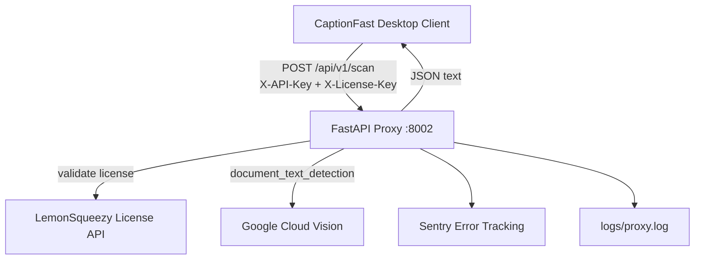

# captionfast-proxy


## About

CaptionFast Proxy is the backend service for CaptionFast badge OCR. It accepts uploaded badge images from licensed desktop clients, validates LemonSqueezy license keys and API keys, and returns extracted VIP names via Google Cloud Vision document text detection.

## System Architecture



## Key Features & Metrics

- **Triple-gate auth** — `X-API-Key` (shared secret), `X-License-Key` (LemonSqueezy validate), and `image/*` content-type check before OCR.
- **Rate limit** — **15 requests/minute** per remote IP via SlowAPI `@limiter.limit("15/minute")`.
- **VIP name extraction heuristic** — filters word annotations at **≥75%** of max bounding-box height (`NAME_HEIGHT_THRESHOLD_RATIO = 0.75`); sorts survivors by `(min_y, min_x)`.
- **Upstream timeouts** — LemonSqueezy validation uses **25.0s** httpx timeout; logs file size in bytes per scan request.

## Technical Implementation Notes

- **Credential bootstrap** — supports base64-encoded `GCP_JSON_KEY` env var (written to temp file) or local `google-credentials.json`; sets `GOOGLE_APPLICATION_CREDENTIALS` at lifespan start.
- **Vision client singleton** — `ImageAnnotatorClient` initialized once in FastAPI lifespan; avoids per-request client allocation.
- **License status blocking** — rejects `expired` and `disabled` LemonSqueezy statuses even when `valid=true`.
- **Sentry full trace sampling** — `traces_sample_rate=1.0` captures all transactions (high observability, higher ingest cost).
- **Frozen-runtime path support** — `_runtime_base_dir()` resolves executable directory for PyInstaller-style deployments.
- **Default port 8002** — overridable via `PORT` env var; Heroku-style `Procfile` runs `python main.py`.

## Local Deployment

```bash
python -m venv .venv
.venv\Scripts\activate        # Windows
pip install -r requirements.txt
copy .env.example .env        # Set PROXY_API_KEY, LEMONSQUEEZY_API_KEY, GCP creds
python main.py
```

Service listens on `http://0.0.0.0:8002`.

## Project Structure

```
captionfast-proxy/
├── main.py              # FastAPI app, OCR, license validation
├── requirements.txt
├── Procfile             # web: python main.py
├── .env.example
├── .python-version      # 3.14
├── google-credentials.json  # local GCP key (gitignored in prod)
└── logs/
    └── proxy.log        # rotating file + stdout handler
```
