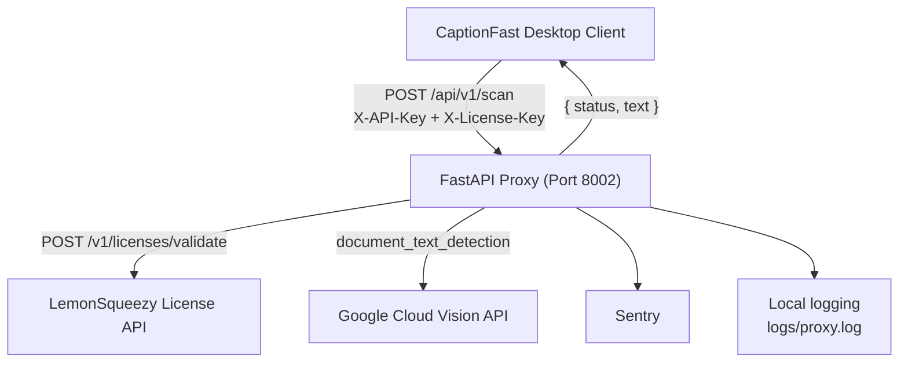

# captionfast-proxy

👉 Note: This is the secure backend proxy for CaptionFast. The Flutter desktop client can be found @captionfast-proxy/ .


CaptionFast Proxy is the B2B gateway in front of paid OCR. Licensed desktop clients never hold Google Cloud or LemonSqueezy credentials. They submit a badge image to a single authenticated route, and this service orchestrates entitlement checks, document-text detection, and VIP-name extraction before a JSON payload returns to the client.

The process binds `0.0.0.0` on port **8002** (`PORT` overrides the default). The contract is `POST /api/v1/scan`.

## Architecture



Request handling is sequential orchestration inside one transaction:

1. Shared-secret gate (`X-API-Key`).
2. Entitlement gate (`X-License-Key` against LemonSqueezy, 25s `httpx` timeout).
3. Payload gate (`Content-Type` must be `image/*`, body must be non-empty).
4. Upstream OCR via a process-lifetime `ImageAnnotatorClient`.
5. Height heuristic over word annotations, then `{"status": "success", "text": ...}`.

Sentry and the `captionfast_proxy` logger sit beside that path. Failures and per-word height decisions are recorded locally; transactions are exported to Sentry at a 100% sample rate.

## Security & Authentication

`POST /api/v1/scan` enforces a **triple-gate auth** pipeline. A request reaches Google Cloud Vision only after all three gates pass. Upstream secrets (`PROXY_API_KEY`, `LEMONSQUEEZY_API_KEY`, and the GCP service-account material) stay on the proxy.

| Gate | Control | Failure |
| --- | --- | --- |
| 1. Client authentication | `X-API-Key` must match `PROXY_API_KEY` | `401 Unauthorized` when the header is missing or does not match. `500` when the server secret is unset. |
| 2. License entitlement | `X-License-Key` is posted to `https://api.lemonsqueezy.com/v1/licenses/validate` with `Authorization: Bearer <LEMONSQUEEZY_API_KEY>` | `403` when the header is missing, `valid` is not `true`, or `license_key.status` is `expired` or `disabled`. `502` when LemonSqueezy is unreachable or returns a non-JSON body. |
| 3. Payload admission | MIME-type check: `Content-Type` must start with `image/`, and the body must contain bytes | `400` for a non-image upload or an empty file. |

Gate 2 treats LemonSqueezy status as authoritative even when `valid` is true. Statuses in `{expired, disabled}` are rejected with `403` and the detail `License is {status}. Please renew or contact support.` That blocks lapsed B2B seats from continuing to spend Vision quota.

Google credentials are resolved once during FastAPI lifespan startup, before the singleton `ImageAnnotatorClient` is constructed:

- `GCP_JSON_KEY` — base64-encoded service-account JSON, or raw JSON. The decoded document is written to a temp `google-credentials.json` and `GOOGLE_APPLICATION_CREDENTIALS` is pointed at that file.
- Otherwise, a `google-credentials.json` beside the process (or beside the frozen executable) is used when present.

`_runtime_base_dir()` resolves the executable directory under a PyInstaller frozen runtime and the working directory otherwise, so credential and log paths stay stable in packaged deploys.

## OCR & Data Extraction

Vision is called with `document_text_detection`. The full-page annotation at index 0 is the unfiltered block and is skipped when per-word annotations exist. Each remaining word contributes its description plus a bounding box.

Badge layouts put the VIP name in the largest type. Titles, companies, and footer lines are smaller. The proxy keeps a word when its box height is at least 75% of the tallest word on that badge:

```text
NAME_HEIGHT_THRESHOLD_RATIO = 0.75
height_threshold = max_height * NAME_HEIGHT_THRESHOLD_RATIO
keep word if height >= height_threshold
```

Height is the Y extent of `bounding_poly.vertices` (`max(y) - min(y)`). Survivors are sorted by `(min_y, min_x)` so tokens reconstruct in reading order, then joined with spaces. Every candidate is logged with `height`, `min_y`, `min_x`, and whether it was kept.

If no word meets the threshold, the extractor falls back to the words whose height equals `max_height`. If Vision returns no per-word annotations, the full text block is returned unchanged. An image with no annotations returns `{"status": "success", "text": ""}`.

## Infrastructure & Reliability

**IP rate limiting.** SlowAPI keys the limiter with `get_remote_address`. The scan route is decorated with `@limiter.limit("15/minute")`, so each remote IP is capped at **15 requests per minute**. The cap sits in front of `document_text_detection` and is the control that keeps a misbehaving or scripted client from driving unbounded Google Cloud Vision billing. `RateLimitExceeded` is registered on the application exception handler.

**Sentry.** `sentry_sdk.init` runs at import with `traces_sample_rate=1.0`. Every transaction is eligible for trace export (100% trace sampling), which gives a complete picture of license-validation latency, Vision calls, and `4xx`/`5xx` paths. Full sampling increases ingest volume in proportion to traffic.

**Local logging.** The `captionfast_proxy` logger writes `INFO` records to stdout and to `logs/proxy.log` using `%(asctime)s | %(levelname)s | %(name)s | %(message)s`. Each accepted scan logs filename, content type, and `file_size_bytes` before the Vision call. License and API-key decisions are logged as pass/fail without writing secret values.

**Process model.** Uvicorn serves `main:app`. A Heroku-style `Procfile` (`web: python main.py`) is the platform entrypoint. The Vision client is created once in the lifespan hook and reused for every scan.

### Scan contract

```http
POST /api/v1/scan
X-API-Key: <PROXY_API_KEY>
X-License-Key: <lemonsqueezy-license-key>
Content-Type: multipart/form-data
```

Success body:

```json
{"status": "success", "text": "Jane Doe"}
```

| Status | Condition |
| --- | --- |
| `200` | Gates passed and OCR completed. `text` may be empty. |
| `400` | Content type is outside `image/*`, or the file is empty. |
| `401` | `X-API-Key` is missing or does not match. |
| `403` | License header missing, key invalid, or status `expired` / `disabled`. |
| `429` | Remote IP exceeded 15 requests in the current minute. |
| `500` | `PROXY_API_KEY` or `LEMONSQUEEZY_API_KEY` unset, Vision client missing, or Vision returned an error message. |
| `502` | LemonSqueezy or the Vision transport call failed. |

## Local deployment

Requires Python 3.14 (`.python-version`).

```bash
python -m venv .venv
source .venv/bin/activate          # Windows: .venv\Scripts\activate
pip install -r requirements.txt
cp .env.example .env               # Windows: copy .env.example .env
python main.py
```

Set at least:

| Variable | Role |
| --- | --- |
| `PROXY_API_KEY` | Shared secret expected in `X-API-Key`. |
| `LEMONSQUEEZY_API_KEY` | Bearer token for LemonSqueezy license validation. |
| `GCP_JSON_KEY` | Base64 or raw service-account JSON. Optional when `google-credentials.json` is present on disk. |
| `PORT` | Listen port. Default `8002`. |

The scan URL for a local client is `http://127.0.0.1:8002/api/v1/scan`.

## Project structure

```
captionfast-proxy/
├── main.py                 # FastAPI app, triple-gate auth, OCR heuristic
├── requirements.txt        # fastapi, uvicorn, google-cloud-vision, sentry-sdk, slowapi, httpx
├── Procfile                # web: python main.py
├── .env.example
├── .python-version         # 3.14
├── google-credentials.json # local GCP key; gitignored
└── logs/
    └── proxy.log           # file handler + stdout mirror
```
